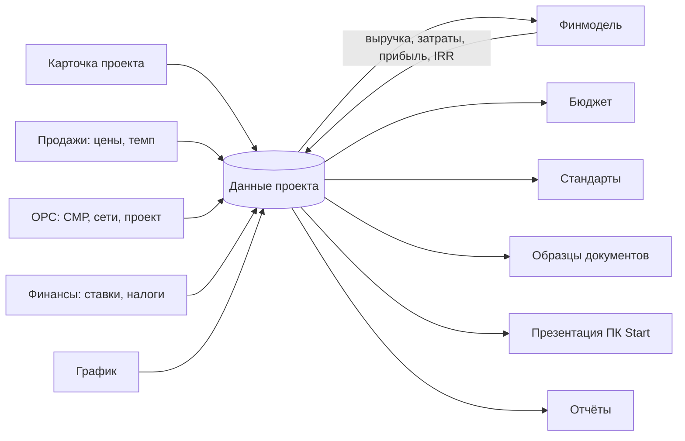
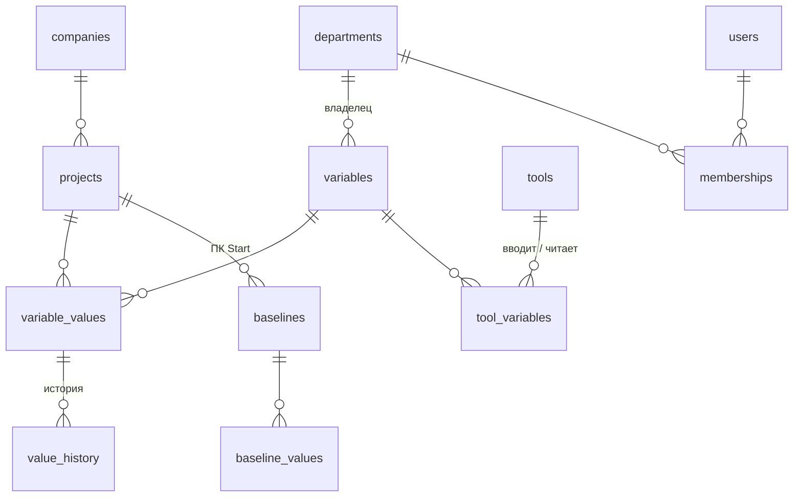

# «Кирпич за кирпичом»: единые данные проекта

Концепция для руководства и IT холдинга BI Group. Черновик, октябрь 2026.

## Проблема

Данные одного ЖК живут в десятке файлов: финмодель, ГПР, сметы, расчёт себестоимости ОРС, бюджет, презентация на проектный комитет, отчёты. Одни и те же цифры вводят заново в каждый файл, и они расходятся.

Пример из презентации ПК Start одного из проектов:

- кладовых в паспорте 25, в финмодели 10;
- реализуемая площадь в паспорте 16 806,95 м², в финмодели 16 705,76 м²;
- стоимость проекта в паспорте 9,2 млрд тг, расходы в финмодели 11,1 млрд тг.

Комитет тратит время на поиск правильной цифры, а не на решение.

## Идея

У проекта один набор данных: словарь переменных. Калькуляторы, отчёты, документы и презентации не хранят свои копии цифр, а берут их из словаря.

> **Главный принцип: никакого повторного ручного ввода.** Одинаковые данные вводятся один раз, и все места, где они показываются или от них что-то считается, обновляются сразу. Если цифру приходится переписывать из одного раздела в другой — это ошибка системы, а не работа для команды.

Пять правил:

1. **Один ввод.** У каждой переменной одно место ввода. Площадь вводится в карточке проекта, цена — у продаж, стоимость СМР — в ОРС. Остальные только читают.
2. **Всё остальное считается.** Выручка, прибыль, себестоимость 1 м², дата ключей — результат расчёта, вручную их не вводят.
3. **Владелец утверждает.** У переменной есть отдел-владелец и статус: черновик → согласовано → утверждено. Если значение поменяли, статус возвращается в «черновик»: утверждали другое число.
4. **Базовая версия.** На проектном комитете Start значения фиксируются. Дальше система показывает отклонения: «СМР +40 000 тг/м² (+15,4%) к утверждённому на ПК Start».
5. **История.** Видно, кто, когда и с какого на какое значение изменил переменную.

## Что уже работает в прототипе

Портал проекта: <https://claude.ai/artifact/U8ExahGRUgt4ogNEt6khPw> (данные общие для команды на claude.ai).

| Раздел | Что делает | Откуда данные |
|---|---|---|
| Данные проекта | Все 158 переменных: значение, владелец, статус, история, базовая версия ПК Start, отклонение; реестр рисков и возможностей | Сам является источником |
| Карточка проекта | Миссия и KPI, паспорт, реквизиты, параметры подбора стандартов | Пишет в данные проекта |
| Смета из 1С | Итоги выгрузки 1С:УСП по объектам, конструктивам и статьям | Пишет в финмодель СМР, сети, проект, надзор и резерв; ручной ввод этих статей отключается |
| Показатели ПНР для ОРС | 193 показателя калькулятора производственно-накладных расходов, выгрузка строка в строку | 83 вводятся здесь, остальные считаются из графика, блоков, данных проекта и чек-листа B0 |
| Чек-лист B0 для ОРС | Анкета для сметы на стадии эскиза, выгрузка в Excel | Читает площади, график и блоки; дописывает только недостающее |
| Блоки проекта | Каждый блок и паркинг: этажность, подземные этажи, подъезды, лифты, квартиры, тип каркаса, вид проектирования | Пишет в данные проекта; количество блоков, этажность и квартиры считаются отсюда |
| Команда проекта | Роли, ФИО, зоны ответственности | Пишет в данные проекта; риски ссылаются на участников команды |
| Партнёры | Генподрядчик, поставщики, проектный институт, банк | Пишет в данные проекта |
| Календарь событий | Старты этапов, ключи, сроки чек-листов и документов, праздники РК | Читает график, дорожную карту и реестр документов |
| Показатели | Сроки, освоение бюджета, маржа, документы, статус данных | Читает график, бюджет, финмодель, реестр документов, словарь |
| Финмодель | Денежный поток, НДС, кредит, КПН, IRR, NPV | Читает площади, цены, затраты, ставки; пишет результаты |
| Шахматка | Этажи и подъезды блоков: стадия СМР, план по этажам, объём план/факт, продажи; квартиры — номер, комнаты, площадь, статус (свободна, бронь, продана, не в продаже) | Сетку строит из «Блоков проекта», план — из графика, объём — из финмодели; номера квартир сквозные по блоку; продажи этажа считаются по статусам квартир; вводится только факт; пишет «Готовность СМР», «Выполнено СМР», «Продано квартир», «Квартир в брони», «Площадь квартир по шахматке» |
| Дорожная карта | Этапы проекта по фазам: сроки по графику (план и прогноз), выполнение пунктов, просрочки и инструменты каждого этапа; схема связей этапов — отдельным видом | Основа портала: разделы (блоки, шахматка, бюджет, B0, ПНР, смета…) — инструменты этапов, связь в `TOOL_STAGES` |
| Сегодня | Стартовый экран: что требует внимания (просроченные пункты, документы на продление, отставание графика и стройки, продажи ниже плана, перерасход, данные на согласовании) и события ближайшего месяца | Ничего не хранит: всё считается из графика, реестра сроков, шахматки, бюджета и статусов данных |
| Планировки | Типовые планировки: помещения (вид, название, площадь), площадь квартиры с коэффициентами для лоджий и балконов, жилая площадь, комнатность | Квартира шахматки ссылается на планировку по id; когда площадь есть у всех квартир, «Продаваемая жилая площадь» считается по шахматке и уходит в финмодель, ТЭП и презентацию |
| Что если | Сценарии: цена, СМР, задержка старта, темп продаж, ставка | Хранит только отклонения от базы; итоги считает финмодель на данных проекта, проект не меняет |
| График | Ганта из связей этапов, критический путь, прогноз ключей | Пишет старт проекта, считает даты ключей |
| Бюджет | План по этапам считается из финмодели автоматически, команда вносит только факт | Читает финмодель |
| Стандарты | Подбор по региону, городу, классу, этапу, виду работ | Читает карточку и текущий этап |
| Образцы документов | 37 шаблонов на русском и казахском | Подставляют название, адрес, застройщика, площади |
| Дорожная карта | 21 этап с чек-листами, включая ПК Start | Даёт текущий этап и прогресс |
| Презентация ПК Start | 11 слайдов, выгрузка в PowerPoint и PDF | Целиком из данных проекта: миссия и KPI, паспорт, ГПР СМР, цены, затраты, финмодель, статус данных и отклонения, риски, команда |
| График: режим «Только СМР» | ГПР от старта СМР до ввода | Те же этапы и длительности, что у всего графика |

Устранённые дубли:

- **Общая площадь здания** раньше вводилась и в карточке, и в финмодели. Теперь это одна переменная `area_total`: изменили в любом месте — поменялось везде.
- **Сроки** раньше велись дважды: месяцами в финмодели и этапами в графике. Теперь финмодель берёт их из плана графика: покупка земли — конец этапа «Земельный участок», проектирование — от АПЗ и изысканий до конца экспертизы, стройка — от старта СМР до ввода в эксплуатацию, продажи — от долевого участия до передачи квартир.
- **Календарь** раньше был списком вписанных дат: ключи стояли на 20.12.2028, а график считал другую дату. Теперь календарь собирается из графика (старты этапов, ключи по плану и прогнозу), сроков пунктов чек-листов и реестра документов. Праздники РК — справочник.
- **Сводка показателей** раньше показывала вписанные цифры. Теперь сроки берутся из графика, освоение — из бюджета, маржа и IRR — из финмодели, документы — из реестра сроков, статус данных — из словаря. Показатели без источника данных (качество, охрана труда, шахматка продаж) убраны до подключения журналов и CRM.
- **Ответственный за риск** хранится ссылкой на участника команды, а не копией текста: переименовали роль или вписали ФИО — реестр рисков и презентация показывают новое.
- **Партнёры** хранятся в данных проекта вместо вписанного примера.
- **Блоки, этажность, квартиры** вводились в карточке одним числом, а чек-лист B0 и калькулятор ПНР просят их по каждому блоку. Теперь есть список блоков, а итоги в карточке, документах и презентации считаются из него.
- **План бюджета** раньше переносили из финмодели кнопкой, и после правки финмодели он устаревал. Теперь план всегда считается из финмодели: земля, проектирование по этапам проекта, СМР с технадзором и резервом по этапам стройки, сети, маркетинг, административные расходы и проценты. Вручную вносится только факт.

Разбор таблиц ОРС (чек-лист B0, калькулятор ПНР, смета из 1С) и план их переноса: [excel-ors.md](excel-ors.md).

## Словарь переменных

Полный список: [variables.md](variables.md). 158 переменных в 14 разделах: миссия и KPI, локация и клиент, паспорт и ТЭП, участок и реквизиты, подбор стандартов, продажи, затраты, финансирование и налоги, сроки, результаты финмодели, ход проекта и три раздела показателей ПНР (ФМ проекта, ОРС Общестрой, ОРС Сети).

Для каждой переменной указаны код, название, единица, тип, отдел-владелец, где вводится и какие инструменты её используют.

## Как связаны инструменты

## Смежные отделы

Пока владельцы переменных размечены черновиком: команда проекта, развитие, юристы, продажи, ОРС, финансы. Следующим шагом добавляются снабжение, логистика и другие отделы холдинга:

- у каждого отдела свои переменные, которые он вводит и утверждает;
- команда проекта отправляет отделу запрос («ОРС, нужна себестоимость по новому ТЭП до пятницы»), ответ приходит сразу в данные проекта.

Список отделов и их переменных согласуется с руководителями отделов.

## Модель данных для IT

Черновик схемы PostgreSQL: [db/project-data.sql](db/project-data.sql), проверка правил: [db/project-data-check.sql](db/project-data-check.sql).

Правила, которые обеспечивает сама база:

- у переменной ровно одно место ввода;
- изменение значения пишет историю и возвращает статус в «черновик»;
- историю нельзя исправить задним числом;
- значение проверяется по типу переменной (число, текст, месяц, да/нет);
- расчётные переменные не согласуют и не утверждают;
- отклонения от базовой версии считаются представлением `v_baseline_delta`.

## Этапы внедрения

| Этап | Что делаем | Где живут данные |
|---|---|---|
| 1. Прототип (сейчас) | Словарь, данные проекта, связка карточки, финмодели, графика, стандартов и документов | claude.ai |
| 2. Пилот | 1–2 реальных проекта, словарь согласован с отделами, владельцы назначены | claude.ai |
| 3. Платформа | Сервер и PostgreSQL в казахстанском облаке, вход сотрудников, роли отделов | Сервер холдинга |
| 4. Отделы | ОРС, снабжение, логистика, продажи работают в системе, запросы между отделами | Сервер холдинга |
| 5. Интеграции | 1С: справочники, факт затрат и оплат | Сервер + 1С |

## Открытые вопросы

1. Перечень смежных отделов и какие переменные каждый вводит и утверждает.
2. Какие данные закрыты (себестоимость, маржа) и кто их видит.
3. Какие данные уже живут в 1С и должны приходить оттуда.
4. Базовая версия только на ПК Start или есть другие контрольные точки.
