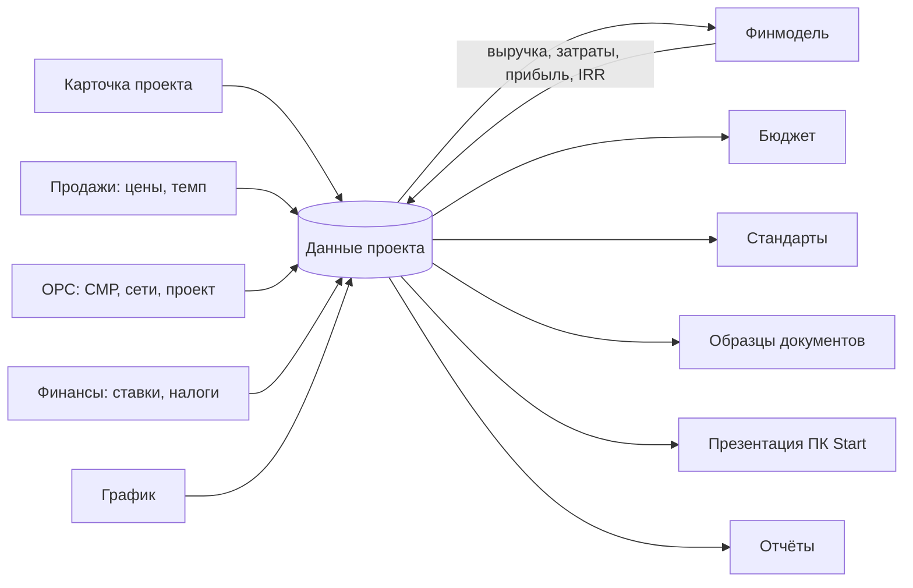
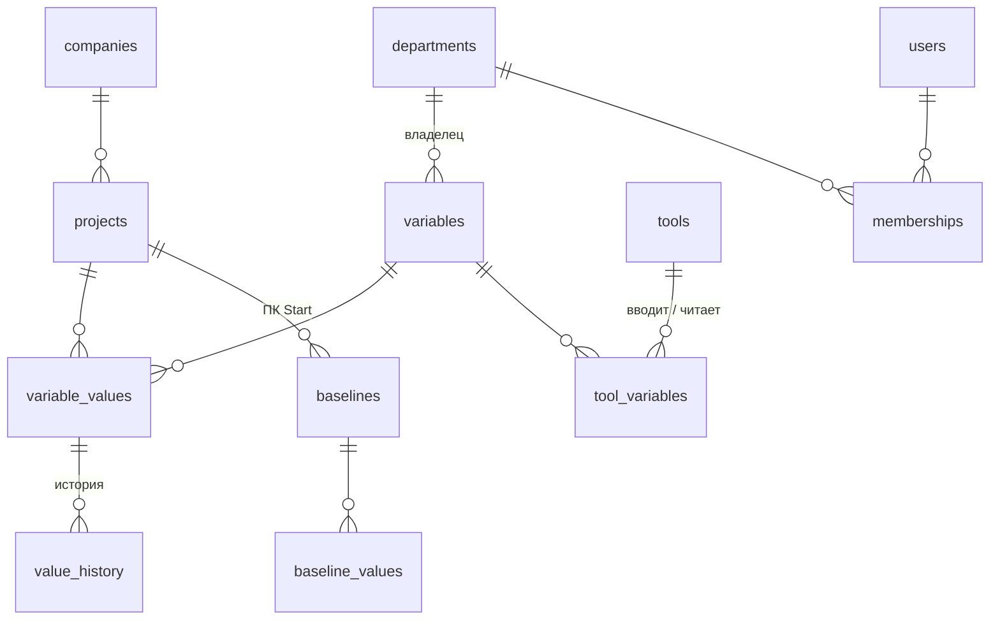

# «Кирпич за кирпичом»: единые данные проекта

Концепция для руководства и IT холдинга BI Group. Черновик, октябрь 2026.

## Проблема

Данные одного ЖК живут в десятке файлов: финмодель, ГПР, сметы, расчёт себестоимости ОРС, бюджет, презентация на проектный комитет, отчёты. Одни и те же цифры вводят заново в каждый файл, и они расходятся.

Пример из презентации ПК Start одного из проектов:

- кладовых в паспорте 25, в финмодели 10;
- реализуемая площадь в паспорте 16 806,95 м², в финмодели 16 705,76 м²;
- стоимость проекта в паспорте 9,2 млрд тг, расходы в финмодели 11,1 млрд тг.

Комитет тратит время на поиск правильной цифры, а не на решение.

## Идея

У проекта один набор данных: словарь переменных. Калькуляторы, отчёты, документы и презентации не хранят свои копии цифр, а берут их из словаря.

Пять правил:

1. **Один ввод.** У каждой переменной одно место ввода. Площадь вводится в карточке проекта, цена — у продаж, стоимость СМР — в ОРС. Остальные только читают.
2. **Всё остальное считается.** Выручка, прибыль, себестоимость 1 м², дата ключей — результат расчёта, вручную их не вводят.
3. **Владелец утверждает.** У переменной есть отдел-владелец и статус: черновик → согласовано → утверждено. Если значение поменяли, статус возвращается в «черновик»: утверждали другое число.
4. **Базовая версия.** На проектном комитете Start значения фиксируются. Дальше система показывает отклонения: «СМР +40 000 тг/м² (+15,4%) к утверждённому на ПК Start».
5. **История.** Видно, кто, когда и с какого на какое значение изменил переменную.

## Что уже работает в прототипе

Портал проекта: <https://claude.ai/artifact/U8ExahGRUgt4ogNEt6khPw> (данные общие для команды на claude.ai).

| Раздел | Что делает | Откуда данные |
|---|---|---|
| Данные проекта | Все 64 переменные: значение, владелец, статус, история, базовая версия ПК Start, отклонение | Сам является источником |
| Карточка проекта | Паспорт, реквизиты, параметры подбора стандартов | Пишет в данные проекта |
| Финмодель | Денежный поток, НДС, кредит, КПН, IRR, NPV | Читает площади, цены, затраты, ставки; пишет результаты |
| График | Ганта из связей этапов, критический путь, прогноз ключей | Пишет старт проекта, считает даты ключей |
| Бюджет | План и факт по этапам, план из финмодели | Читает финмодель |
| Стандарты | Подбор по региону, городу, классу, этапу, виду работ | Читает карточку и текущий этап |
| Образцы документов | 37 шаблонов на русском и казахском | Подставляют название, адрес, застройщика, площади |
| Дорожная карта | 21 этап с чек-листами, включая ПК Start | Даёт текущий этап и прогресс |

Устранённые дубли:

- **Общая площадь здания** раньше вводилась и в карточке, и в финмодели. Теперь это одна переменная `area_total`: изменили в любом месте — поменялось везде.
- **Сроки** раньше велись дважды: месяцами в финмодели и этапами в графике. Теперь финмодель берёт их из плана графика: покупка земли — конец этапа «Земельный участок», проектирование — от АПЗ и изысканий до конца экспертизы, стройка — от старта СМР до ввода в эксплуатацию, продажи — от долевого участия до передачи квартир.

## Словарь переменных

Полный список: [variables.md](variables.md). 64 переменные в 9 разделах: паспорт и ТЭП, участок и реквизиты, подбор стандартов, продажи, затраты, финансирование и налоги, сроки, результаты финмодели, ход проекта.

Для каждой переменной указаны код, название, единица, тип, отдел-владелец, где вводится и какие инструменты её используют.

## Как связаны инструменты

## Смежные отделы

Пока владельцы переменных размечены черновиком: команда проекта, развитие, юристы, продажи, ОРС, финансы. Следующим шагом добавляются снабжение, логистика и другие отделы холдинга:

- у каждого отдела свои переменные, которые он вводит и утверждает;
- команда проекта отправляет отделу запрос («ОРС, нужна себестоимость по новому ТЭП до пятницы»), ответ приходит сразу в данные проекта.

Список отделов и их переменных согласуется с руководителями отделов.

## Модель данных для IT

Черновик схемы PostgreSQL: [db/project-data.sql](db/project-data.sql), проверка правил: [db/project-data-check.sql](db/project-data-check.sql).

Правила, которые обеспечивает сама база:

- у переменной ровно одно место ввода;
- изменение значения пишет историю и возвращает статус в «черновик»;
- историю нельзя исправить задним числом;
- значение проверяется по типу переменной (число, текст, месяц, да/нет);
- расчётные переменные не согласуют и не утверждают;
- отклонения от базовой версии считаются представлением `v_baseline_delta`.

## Этапы внедрения

| Этап | Что делаем | Где живут данные |
|---|---|---|
| 1. Прототип (сейчас) | Словарь, данные проекта, связка карточки, финмодели, графика, стандартов и документов | claude.ai |
| 2. Пилот | 1–2 реальных проекта, словарь согласован с отделами, владельцы назначены | claude.ai |
| 3. Платформа | Сервер и PostgreSQL в казахстанском облаке, вход сотрудников, роли отделов | Сервер холдинга |
| 4. Отделы | ОРС, снабжение, логистика, продажи работают в системе, запросы между отделами | Сервер холдинга |
| 5. Интеграции | 1С: справочники, факт затрат и оплат | Сервер + 1С |

## Открытые вопросы

1. Перечень смежных отделов и какие переменные каждый вводит и утверждает.
2. Какие данные закрыты (себестоимость, маржа) и кто их видит.
3. Какие данные уже живут в 1С и должны приходить оттуда.
4. Базовая версия только на ПК Start или есть другие контрольные точки.
