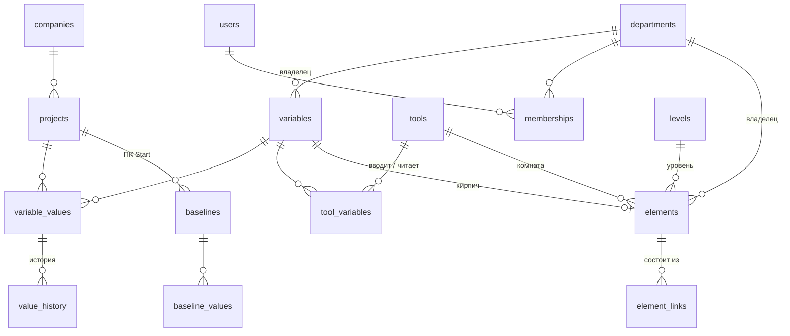

# База данных проекта: для IT

Технические подробности концепции «Кирпич за кирпичом» ([concept.md](../concept.md)): схема PostgreSQL, структура «от кирпича до ЖК» в базе и как она собирается из портала.

## Запуск проверок

```bash
psql -v ON_ERROR_STOP=1 -f docs/db/project-data.sql -f docs/db/project-data-check.sql
```

Структура из портала — на отдельной чистой базе:

```bash
psql -v ON_ERROR_STOP=1 -f docs/db/project-data.sql -f docs/db/structure-seed.sql -f docs/db/structure-seed-check.sql
```

`structure-seed.sql` генерирует `node scripts/export-skill-tree.js` из `prototype/index.html` (руками не правится, CI сверяет).

## Уровни структуры и коды

| Уровень | Код | Что это в портале | Что появляется на уровне | Какое правило здесь работает |
|---|---|---|---|---|
| Кирпич | `atom` | переменная словаря (`window.VARS`) | значение | **один ввод**: одно место ввода |
| Стена | `operation` | расчёт (`calc`) или одно действие | действие: из входа получается результат | **всё остальное считается** |
| Комната | `process` | раздел или инструмент: ОРС, ГПР, финмодель | готовый результат, которым пользуются | читает данные через `window.ZHK`, копий не хранит |
| Квартира | `area` | направление отдела | хозяин: отвечает один отдел | **владелец утверждает** |
| Этаж | `stage` | этап дорожной карты (`STAGE_STEPS`) | порядок: шаги этапа, «Дальше» | этап идёт после предыдущего |
| Дом | `project` | проект | паспорт: цель, бюджет, сроки | **базовая версия** ПК Start |
| Жилой комплекс | `portfolio` | холдинг или портфель | общее: справочники `DICTS`, шаблоны, ставки отделов | одно значение для всех проектов |

**Что нужно этапу** задаётся в `window.STAGE_NEEDS` (`<script id="stage-steps">`) по смыслу пунктов чек-листа: обычно 2–18 значений и списков. Этап состоит из этих данных и своего чек-листа и готов, когда данные утверждены, списки заполнены, пункты отмечены. Шаги этапа (`STAGE_STEPS`) — где ещё работать, в готовность не входят: в базе это связь `step`. Каждый уровень собран из элементов уровней ниже и добавляет то, чего не было ни у одной его части: кирпич сам по себе ничего не значит, стена уже что-то делает, в комнате можно жить.

## Схема и правила базы

Черновик схемы PostgreSQL: [db/project-data.sql](db/project-data.sql), проверка правил: [db/project-data-check.sql](db/project-data-check.sql).



Правила, которые обеспечивает сама база:

- у переменной ровно одно место ввода;
- изменение значения пишет историю и возвращает статус в «черновик»;
- историю нельзя исправить задним числом;
- значение проверяется по типу переменной (число, текст, месяц, да/нет);
- расчётные переменные не согласуют и не утверждают;
- отклонения от базовой версии считаются представлением `v_baseline_delta`.
- структура «от кирпича до ЖК» (`levels`, `elements`, `element_links`): элемент собирается только из уровней ниже; кирпич — это переменная словаря, и только он; у направления (`area`) есть отдел-владелец;
- входы и результат есть только у стены; расчётную переменную считает ровно одна стена, вводимую — ни одна;
- `v_element_atoms` показывает, из каких переменных собран элемент, и в обратную сторону — что затронет изменение переменной;
- `v_element_status` считает готовность элемента по проекту: готов, когда все вводимые переменные внутри утверждены; если входы не размечены, готовность пустая, а не «готово».

Существующие таблицы не меняются: `variables` — кирпичи, `tools` — комнаты-инструменты, `projects` — дома, `companies` — ЖК.

Страница «Структура» и база собирают структуру одним кодом — `window.buildStructure` (`<script id="structure">`), поэтому дерево на сайте и таблицы в базе не расходятся. Наполнение структуры не вводится вручную: [db/structure-seed.sql](db/structure-seed.sql) генерирует `node scripts/export-skill-tree.js` из портала, CI сверяет файл с порталом и проверяет его правилами [db/structure-seed-check.sql](db/structure-seed-check.sql). Откуда что берётся:

| Уровень | Источник в портале |
|---|---|
| Кирпичи | словарь `window.VARS` — все переменные; списки проекта `window.VARS.lists` — блоки, шахматка, план спецтехники и чек-листы этапов |
| Стены | переменные с `calc`: у каждой одна стена-расчёт, её результат — эта переменная; входы стены — `from` (из каких переменных считается) |
| Комнаты | разделы портала: шаги этапов и разделы, которые считают переменные (`calc`); в комнату входят и переменные, которые в ней вводятся — по началу `path` через `window.VARS.homes` (карточка, финмодель, график, ПНР, спецтехника) |
| Квартиры | направления отделов `window.VARS.areas`: отдел и разделы, которые он ведёт (Финансы — финмодель, бюджет, смета 1С и «что если»; ОРС — чек-лист B0 и показатели ПНР; Продажи — шахматка; Стройка — акты и спецтехника; Команда проекта — остальные разделы: карточка, график, этапы, сроки документов, данные, блоки, команда, партнёры, планировки, показатели, стандарты, презентация ПК Start) |
| Этажи | этапы дорожной карты по порядку, шаги — из `window.STAGE_STEPS` (`<script id="stage-steps">`) с текстом «что сделать» |

Входы расчётов размечены в `window.VARS` полем `from` по формулам портала. Большие группы не переписываются, а вычисляются: `@model` — все исходные данные финмодели (ключи `window.MODEL_DEFAULTS`), `@pnr` — все показатели калькулятора ПНР. Пустой `from` — расчёт идёт не из переменных, а из списков проекта (блоки, шахматка, план спецтехники), чек-листов или файла отдела; готовность такого расчёта пустая. Цепочка расчётов учитывается: старт графика → сроки продаж → прибыль, поэтому изменение старта видно на прибыли, IRR и этапах, где они нужны. Проверка `check-skill-tree.js` следит, чтобы входы были у каждого расчёта, ссылались на существующие переменные и не образовывали цикл.

Каждый раздел структуры закреплён ровно за одним отделом: это проверяют `check-skill-tree.js` и `structure-seed-check.sql`. Правило «один ввод» база проверяет и на наполнении: у каждой вводимой переменной ровно одна комната ввода и одна строка `writes` в `tool_variables`. Готовность комнаты учитывает и её поля: карточка готова, когда утверждены все её 24 поля.

**Списки проекта — тоже кирпичи.** У блоков и шахматки переменное число строк, поэтому это не переменные словаря, а списки: справочник `lists` (как `variables`) и строки проекта `list_rows`. Список вводится в своём разделе, его владелец — отдел этого раздела. Расчёт из списка указывает его в `fromLists`: число блоков, этажность и квартиры — из блоков, продажи и готовность СМР — из шахматки и блоков. Список готов, когда в нём есть строки, как шаг «Блоки проекта» на дорожной карте. План спецтехники — такой же список, из него считается стоимость плана. **Чек-лист этапа** — тоже список (отмеченные пункты), но у каждого этапа свой: он входит в свой этаж и готов, когда отмечены все пункты (`need_rows` — число пунктов, берётся из дорожной карты). Из чек-листов считаются текущий этап и число пройденных этапов. Цепочка идёт дальше: шахматка → площадь квартир → выручка и прибыль, поэтому пустая шахматка видна на финмодели и этапах.

Чего в портале пока нет, того нет и в базе:

- **файл ЦДС/ПТО** — сумма по файлу спецтехники (`eq_sum`) считается из файла отдела, он не кирпич: цены остаются в файле, в проект пишется только итог.
