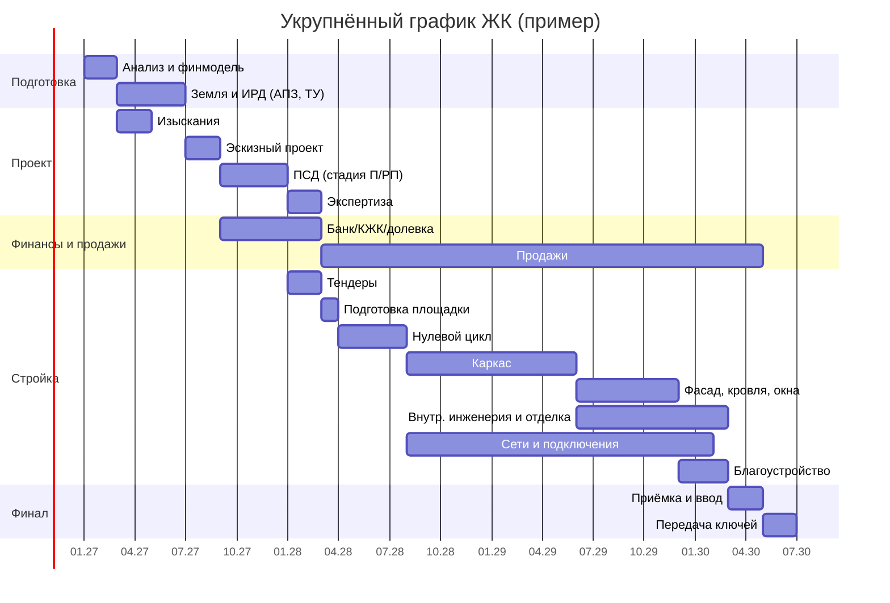

# Дорожная карта строительства ЖК в Казахстане

Полный цикл девелоперского проекта многоквартирного жилого комплекса — от идеи до передачи ключей и гарантийного обслуживания — с учётом законодательства, норм и климатических условий Республики Казахстан.

> ⚠️ Законодательство РК в строительстве активно меняется (новый Налоговый кодекс с 2026 г., реформа градостроительного законодательства, правила долевого участия). Перед каждым этапом сверяйте актуальные редакции на [adilet.zan.kz](https://adilet.zan.kz) и консультируйтесь с юристом. Цифры по срокам и бюджету — ориентиры, а не норматив.

---

## 0. Общая картина

**Типовой проект для примера:** ЖК комфорт-класса, 3–5 блоков по 9–12 этажей, ~25–40 тыс. м² жилой площади, монолитный каркас.

| № | Фаза | Длительность | Доля бюджета* |
|---|------|--------------|---------------|
| 1 | Предынвестиционная стадия (анализ, концепция, финмодель) | 1–3 мес. | 0,5–1% |
| 2 | Земельный участок и исходно-разрешительная документация (ИРД) | 2–6 мес. | 10–20% (земля) |
| 3 | Изыскания и проектирование (ЭП → ПСД) | 4–8 мес. | 3–5% |
| 4 | Комплексная вневедомственная экспертиза | 1–3 мес. | 0,3–0,5% |
| 5 | Структура финансирования и запуск продаж | параллельно с 3–4 | 1–3% (маркетинг) |
| 6 | Тендеры и закупки | 1–2 мес. | — |
| 6а | Проектный комитет «Start»: решение о запуске продаж и СМР | 2–4 нед. | — |
| 7 | Подготовка площадки и уведомление о начале СМР | 0,5–1 мес. | 1–2% |
| 8 | Строительно-монтажные работы | 18–30 мес. | 55–65% |
| 9 | Внешние инженерные сети и подключения | параллельно с 8 | 5–10% |
| 10 | Приёмка и ввод в эксплуатацию | 1–2 мес. | <1% |
| 11 | Регистрация, передача квартир, гарантия | 1–3 мес. + 2+ года | 1–2% |

\* Доли условные, сильно зависят от города, цены земли и класса жилья.

**Итого:** от идеи до ключей — обычно **3–4 года**; на одну очередь при параллельной работе — 2–2,5 года.

---

## 1. Предынвестиционная стадия

**Цель:** понять, стоит ли входить в проект, и с каким продуктом.

### 1.1. Анализ рынка
- Город и район: Алматы, Астана, Шымкент — самые ёмкие рынки; областные центры (Актобе, Караганда, Атырау, Актау, Усть-Каменогорск, Костанай и др.) — ниже цены, но и ниже конкуренция.
- Спрос: уровень доходов, ипотечные программы (Отбасы банк, «Наурыз», «Отау», программы МИО и АО «Казахстанская жилищная компания» — проверьте, какие действуют на дату запуска), миграция в город.
- Конкуренты в радиусе 2–3 км: цена за м², темп продаж, квартирография, класс, сроки сдачи.
- Классы: эконом / комфорт / бизнес / премиум (классы комфортности по СП РК 3.02-101 «Здания жилые многоквартирные»).

### 1.2. Анализ участков
- Целевое назначение земли, категория, обременения, зонирование по Генплану и ПДП (проекту детальной планировки).
- Допустимая плотность, этажность, высотные ограничения (аэропорты, охранные зоны ЛЭП, газопроводов, водоохранные зоны).
- Наличие и мощность инженерных сетей рядом — **ключевой фактор стоимости**.
- Геология: просадочные грунты (юг), высокие грунтовые воды (Астана, Атырау), **сейсмичность** (Алматы и юг — 8–10 баллов, удорожание каркаса на 10–25%).
- Транспорт, школы, детсады, поликлиники — нагрузка на социальную инфраструктуру.

### 1.3. Концепция продукта
- Квартирография (доля студий/1-2-3-комнатных), площади, планировки.
- Паркинг (подземный/наземный), коммерция на первых этажах, двор без машин, детские и спортивные площадки.
- Конструктив: монолит, сборно-монолитный каркас, крупнопанельное (КПД), кирпич.

### 1.4. Финансовая модель
- Выручка: площадь к продаже × цена × график продаж (с учётом роста цены по стадиям готовности).
- Расходы: земля, ИРД, проект, экспертиза, СМР, сети и плата за подключение, технадзор, маркетинг и агентские, налоги, проценты по кредиту, резерв 5–10%.
- Налоги: КПН 20%, НДС (с 2026 г. ставка 16% — уточните порядок освобождения при реализации жилья по новому НК), имущественный и земельный налоги, налоги с ФОТ.
- Показатели: NPV, IRR, маржинальность (цель — 20–30% к себестоимости), пиковый долг, точка безубыточности, чувствительность к цене м² и стоимости СМР.

**Результат фазы:** инвестиционный меморандум, решение «go / no-go».

---

## 2. Земельный участок и ИРД

### 2.1. Получение права на землю
Варианты:
- **Покупка** участка в частной собственности или права аренды у владельца (через договор купли-продажи / переуступки, регистрация в НАО «Правительство для граждан»).
- **Торги (аукцион/конкурс) МИО** — через портал [e-auction.gosreestr.kz](https://e-auction.gosreestr.kz) / акимат.
- **Совместная деятельность** с собственником земли (доля квартирами).
- **Государственно-частное партнёрство**, участие в госпрограммах через акимат/СПК.

Проверка (due diligence): идентификационный документ на землю, кадастровый номер, отсутствие арестов и залогов, споров, правильное целевое назначение («для строительства многоквартирного жилого комплекса»). При необходимости — **изменение целевого назначения** через акимат.

### 2.2. Юридическая структура
- Отдельное ТОО-застройщик под проект (SPV) — проще для банка, КЖК и дольщиков.
- Лицензии: у застройщика/генподрядчика — государственная лицензия на строительно-монтажные работы нужной категории; у проектировщика — на проектную деятельность; у изыскателей — на изыскательскую.

### 2.3. Исходно-разрешительная документация
Подаётся в основном электронно через **e-qurylys / egov.kz / ГБД «Е-лицензирование»**:
1. **Эскиз/ситуационная схема** и **АПЗ** (архитектурно-планировочное задание) — от управления архитектуры и градостроительства (УАГ) акимата.
2. **Технические условия (ТУ)** на подключение:
   - электроснабжение (региональная электросетевая компания — «АЖК» в Алматы, «Астана-РЭК» в Астане и т.д.);
   - водоснабжение и водоотведение (водоканал);
   - теплоснабжение (тепловые сети / ТЭЦ) или газ (АО «QazaqGaz Аймак») для автономных котельных;
   - ливневая канализация, телеком.
3. **Топографическая съёмка** (М 1:500).
4. **Экологическая оценка** по Экологическому кодексу РК (2021): определение категории объекта, при необходимости — заявление о намечаемой деятельности / скрининг, декларация о воздействии.
5. Согласования: охранные зоны, памятники культуры (если есть), ГО и ЧС, санитарно-эпидемиологические требования.

⚡ **Совет:** заявки на ТУ подавайте максимально рано — ожидание мощностей (особенно электричества и тепла в Алматы и Астане) может стать главным тормозом проекта. Сразу закладывайте в бюджет плату за подключение и строительство внеплощадочных сетей.

---

## 3. Изыскания и проектирование

### 3.1. Инженерные изыскания
- Инженерно-геологические (бурение скважин, лабораторные испытания грунтов, уровень грунтовых вод).
- Инженерно-геодезические.
- Сейсмическое микрорайонирование (для сейсмоопасных зон).
- Инженерно-экологические — при необходимости.

### 3.2. Стадии проектирования
1. **Эскизный проект (ЭП)** — объёмно-планировочное решение, фасады, генплан. Согласование с УАГ (через портал), в Алматы и Астане — с градостроительным советом для значимых объектов.
2. **Проект (П)** / **Рабочий проект (РП)** — полный комплект ПСД:
   - генеральный план и благоустройство;
   - архитектурные решения (АР), конструктивные (КЖ, КМ);
   - инженерные системы: ОВ, ВК, ЭОМ, СС (слаботочка), АПС и пожаротушение, лифты, ИТП;
   - ПОС (проект организации строительства) и ППР;
   - ООС (охрана окружающей среды);
   - энергоэффективность;
   - сметная документация (по сметным нормативам РК).
3. **Рабочая документация (РД)** — детальные чертежи для стройки.

### 3.3. Ключевые нормы РК
- СП РК 3.02-101 «Здания жилые многоквартирные».
- СП РК 2.03-30 «Строительство в сейсмических зонах».
- СП РК 2.04-01 «Строительная климатология» (Астана: расчётная зимняя температура около −31…−35 °C; юг — жаркое лето).
- Нормы пожарной безопасности (технический регламент «Общие требования к пожарной безопасности»), СН/СП РК по инсоляции, доступности для маломобильных групп, теплозащите, шумозащите.
- Требования к парковкам, детским и спортивным площадкам, озеленению — по ПДП и правилам благоустройства города.

---

## 4. Комплексная вневедомственная экспертиза

- Проводится **РГП «Госэкспертиза»** или **аккредитованной частной экспертной организацией** (для проектов с бюджетными деньгами — как правило, Госэкспертиза).
- Проверяется соответствие ПСД нормам, сметы, ИРД.
- Срок: обычно 1–3 месяца в зависимости от сложности, с учётом снятия замечаний.
- **Результат:** положительное заключение — основание для начала СМР и для привлечения денег дольщиков.

---

## 5. Финансирование и продажи

### 5.1. Источники
- **Собственный капитал** девелопера — банки и КЖК требуют обычно 10–30% собственного участия (земля + ПСД засчитываются).
- **Проектное финансирование БВУ** (Halyk, Bereke, Jusan, ForteBank, Банк ЦентрКредит и др.) — под залог земли и прав требования.
- **АО «Казахстанская жилищная компания» (КЖК)** — гарантия завершения долевого строительства, кредитование застройщиков в рамках госпрограмм.
- **Средства дольщиков** по Закону РК «О долевом участии в жилищном строительстве».
- **Кредитование МИО** / выкуп квартир акиматом (для арендного/социального жилья).
- **Ипотечные программы для покупателей**: Отбасы банк, БВУ, госпрограммы (условия меняются — проверяйте ежегодно).

### 5.2. Долевое участие — три способа
По Закону «О долевом участии в жилищном строительстве»:
1. **С гарантией КЖК** — продажи с самого начала стройки, нужно соответствовать требованиям к застройщику (опыт, собственное участие, земля, ПСД) и платить гарантийный взнос.
2. **С участием уполномоченной компании** — специальное ТОО, которому передаются земля и проект; продажи — после возведения части объекта.
3. **После возведения каркаса** — без гарантии КЖК, продажи начинаются после завершения каркаса здания (застройщик строит до этого на свои/банковские).

Обязательные элементы:
- **Разрешение МИО на привлечение денег дольщиков.**
- **Инжиниринговая компания** — контролирует целевое использование денег и ход строительства.
- Деньги дольщиков — на отдельный счёт в банке, расходуются только на объект.
- Договоры ДДУ регистрируются в единой информационной системе долевого строительства.

❗ Продажа квартир «по предварительным договорам», «паям» или через жилищные кооперативы в обход закона — **незаконна** и грозит уголовной ответственностью. Не используйте серые схемы.

### 5.3. Маркетинг и продажи
- Бренд ЖК, сайт, шоурум/отдел продаж, 3D-туры.
- Каналы: Krisha.kz, Instagram, TikTok, 2GIS, агентства недвижимости, партнёрства с банками.
- Ценовая стратегия: ступенчатый рост цены по стадиям (котлован → каркас → фасад → сдача), рассрочка от застройщика.
- CRM, учёт шахматки, ежемесячный отчёт по темпу продаж vs финмодель.

---

## 6. Тендеры и закупки

- **Модель подряда:** генподрядчик «под ключ» (EPC) или застройщик как технический заказчик + несколько подрядчиков.
- Требования к подрядчику: лицензия нужной категории, опыт аналогичных объектов, финансовая устойчивость, своя техника, кадры (ИТР).
- Договор: фиксированная цена или цена с индексацией (учтите волатильность тенге и цен на металл/цемент), график платежей, гарантийные удержания 5–10%, неустойки, страхование СМР.
- Отдельно: **технический надзор** (аккредитованная организация), **авторский надзор** (проектировщик).
- Ключевые закупки с долгим сроком поставки: **лифты** (4–8 мес.), трансформаторные подстанции, окна/витражи, фасадные системы, котельное/ИТП-оборудование.

---

## 6а. Проектный комитет «Start»

Последний шаг перед стартом продаж и строительства. Команда проекта защищает запуск перед комитетом компании, подключаются HR и развитие. Без положительного решения комитета продажи и СМР не начинаются.

Что выносится на комитет (структура презентации):

1. **Паспорт и ТЭП:** участок, класс, блоки и этажность, квартиры, площади, сроки СМР и передачи ключей.
2. **Миссия и KPI:** бюджет, накладные расходы, NPS, срок, вовлечённость команды.
3. **Локация, фасад, сложные узлы.**
4. **Клиент:** технические решения под требования покупателя.
5. **Закупки:** график тендеров, 10 самых капиталоёмких материалов.
6. **Риски, возможности, уроки прошлых проектов.**
7. **ГПР, план выхода людей, стройгенплан.**
8. **Рынок:** бенчмаркинг себестоимости, цены конкурентов, обоснование цены за м².
9. **Финансы:** выручка, затраты, чистая прибыль, рентабельность, IRR.
10. **Люди:** руководитель проекта, команда, карьерные планы.

Частые замечания комитета:

- цифры расходятся между слайдами: площади, число кладовых, стоимость проекта (с НДС или без, что входит);
- зимний старт земляных работ и фасада не внесён в риски;
- цена за м² выше рынка без обоснования, за счёт чего премия.

Решение оформляется протоколом: одобрить запуск или отправить на доработку, утвердить бюджет, цену, сроки и руководителя проекта.

---

## 7. Подготовка площадки и старт СМР

- **Уведомление о начале строительно-монтажных работ** в органы ГАСК (государственного архитектурно-строительного контроля) через портал. К нему прикладываются: положительное заключение экспертизы, договоры с подрядчиком, технадзором, авторнадзором, документ на землю.
- Временное ограждение, бытовой городок, КПП, паспорт объекта на ограждении.
- Временное энергоснабжение и вода.
- Вынос осей в натуру, геодезическая разбивка.
- Вырубка/пересадка деревьев — только по разрешению и с компенсационной посадкой (в Алматы особенно строго).
- Вывоз грунта — согласованные полигоны.

---

## 8. Строительно-монтажные работы

### 8.1. Нулевой цикл (3–5 мес.)
- Котлован, водопонижение, крепление стен котлована.
- Свайное поле или фундаментная плита, гидроизоляция.
- Подземный паркинг, техподполье.
- Обратная засыпка.

### 8.2. Каркас (8–14 мес.)
- Монолитные колонны, стены, перекрытия, лестнично-лифтовые узлы.
- Темп: 1 этаж в 7–14 дней на захватку при нормальных условиях.
- **Зимнее бетонирование** (север и центр РК — с ноября по март): прогрев, противоморозные добавки, тепляки — удорожание и замедление; планируйте каркас на тёплый сезон.
- Лабораторный контроль бетона, акты освидетельствования скрытых работ.

### 8.3. Ограждающие конструкции, кровля, фасад (4–8 мес.)
- Кладка наружных стен и перегородок.
- Кровля, гидроизоляция.
- Окна и витражи («закрыть контур» до холодов).
- Утепление и навесной вентфасад / штукатурный фасад — по расчёту теплозащиты.

### 8.4. Внутренние инженерные системы (6–10 мес., параллельно)
- Отопление, ИТП, водопровод, канализация, вентиляция.
- Электрика, щиты, освещение МОП.
- Слаботочка: домофон, видеонаблюдение, интернет, диспетчеризация.
- Пожарная сигнализация, дымоудаление, пожарный водопровод.
- Лифты — монтаж и экспертиза/освидетельствование.
- Приборы учёта (поквартирные и общедомовые).

### 8.5. Отделка (4–8 мес.)
- МОП (холлы, лестницы, коридоры) — лицо ЖК.
- Квартиры: черновая / предчистовая (white box) / чистовая — по концепции.

### 8.6. Благоустройство (2–4 мес.)
- Дороги, проезды, тротуары, парковки.
- Озеленение, детские и спортивные площадки, МАФ, освещение.
- Мусорные площадки / заглублённые контейнеры.
- Безбарьерная среда.

### 8.7. Управление стройкой
- Еженедельные планёрки, график производства работ (MS Project / Primavera / аналог).
- Контроль качества: технадзор, авторнадзор, лабораторные испытания, исполнительная документация.
- Охрана труда и техника безопасности (требования Трудового кодекса РК), страхование работников.
- Ежемесячный бюджетный контроль: план/факт, остаток к завершению, прогноз.
- Фотофиксация и отчёты для банка, КЖК, инжиниринговой компании, дольщиков.

---

## 9. Внешние сети и подключения

- Строительство внеплощадочных сетей по ТУ: ТП/РП, кабельные линии, водовод, канализационный коллектор, теплотрасса или газопровод.
- Сдача сетей эксплуатирующим организациям, акты разграничения балансовой принадлежности.
- Договоры на поставку услуг (свет, вода, тепло, газ).
- **Риск №1 по срокам** — начинайте параллельно с нулевым циклом.

---

## 10. Приёмка и ввод в эксплуатацию

1. Индивидуальные испытания и пусконаладка инженерных систем.
2. Подготовка исполнительной документации, заключений технадзора и авторнадзора о соответствии.
3. **Декларация о соответствии** от генподрядчика, заключения технадзора и авторнадзора.
4. **Акт приёмки объекта в эксплуатацию** — подписывается заказчиком (собственником), генподрядчиком, технадзором и авторнадзором; регистрируется в установленном порядке (через портал / органы ГАСК).
5. Технический паспорт, присвоение адреса.
6. Первичная регистрация объекта в НАО «Правительство для граждан».

---

## 11. Передача квартир, регистрация, эксплуатация

- Уведомление дольщиков, акты приёма-передачи, обмеры (перерасчёт площадей по договору).
- Регистрация права собственности покупателей (через ЦОН / egov).
- Организация управления: **ОСИ (объединение собственников имущества)** или простое товарищество — по Закону РК «О жилищных отношениях»; до создания ОСИ — временная управляющая компания.
- Передача ОСИ технической документации, ключей от технических помещений.
- **Гарантийный срок** — по закону и договору (ориентир — не менее 2 лет на объект; уточните по действующей редакции закона о долевом участии и ГК РК), отдельный гарантийный отдел для заявок жильцов.
- Закрытие проекта: финальный финансовый отчёт, возврат гарантийных удержаний подрядчикам, погашение кредита, распределение прибыли, разбор уроков («lessons learned») для следующего ЖК.

---

## 12. Основные риски и как их снижать

| Риск | Как снижать |
|------|-------------|
| Задержка ТУ и подключений | Подать заявки на этапе покупки земли, бюджетировать внеплощадочные сети |
| Рост цен на материалы, девальвация тенге | Фикс-цена с подрядчиком, предзакупка металла/цемента, резерв 5–10% |
| Слабые продажи | Тщательный анализ рынка, гибкая квартирография, партнёрство с банками и госпрограммами |
| Изменения законодательства | Юрист в команде, мониторинг adilet.zan.kz, запас по срокам |
| Сейсмика и грунты | Качественные изыскания, опытный конструктор, строгий технадзор |
| Зимний простой | Каркас — на тёплый сезон, контур закрыть до ноября |
| Недобросовестный подрядчик | Проверка через stat.gov.kz / kgd.gov.kz, удержания, поэтапная оплата по факту |
| Претензии дольщиков | Прозрачность, ежемесячные отчёты, соблюдение сроков, качественная гарантия |
| Проверки ГАСК, штрафы | Полная исполнительная документация с первого дня |

---

## 13. Команда проекта

- Руководитель проекта (девелопер).
- Финансовый директор / аналитик финмодели.
- Юрист (земля, долевое участие, договоры).
- Главный инженер проекта (ГИП) и технический заказчик.
- Сметчик / специалист по ценообразованию.
- Отдел закупок.
- Отдел продаж и маркетинга.
- Специалист по ИРД и подключениям («сетевик»).
- Внешние: проектировщик, изыскатели, генподрядчик, технадзор, авторнадзор, инжиниринговая компания, экспертиза, банк.

---

## 14. Чек-лист «старт стройки разрешён»

- [ ] Право на землю зарегистрировано, целевое назначение корректное
- [ ] АПЗ и все ТУ получены
- [ ] Эскизный проект согласован
- [ ] ПСД разработана, получено положительное заключение экспертизы
- [ ] Экологические процедуры пройдены
- [ ] Финансирование закрыто (банк / КЖК / собственные)
- [ ] Генподрядчик с лицензией выбран, договор подписан
- [ ] Проектный комитет «Start» одобрил запуск, протокол подписан
- [ ] Договоры технадзора и авторнадзора подписаны
- [ ] Уведомление о начале СМР подано в ГАСК
- [ ] (Для долевки) Разрешение МИО, инжиниринговая компания, спецсчёт

---

## 15. Основная нормативная база РК

- Земельный кодекс РК.
- Закон РК «Об архитектурной, градостроительной и строительной деятельности в РК» (и/или новый кодифицированный акт — проверьте статус).
- Закон РК «О долевом участии в жилищном строительстве».
- Закон РК «О жилищных отношениях».
- Закон РК «О разрешениях и уведомлениях».
- Экологический кодекс РК.
- Налоговый кодекс РК (новая редакция с 01.01.2026).
- Гражданский кодекс РК (договор строительного подряда).
- Трудовой кодекс РК (охрана труда).
- Своды правил и строительные нормы РК (СП РК, СН РК), технические регламенты.

---

*Документ — ориентир для планирования. Конкретные сроки, суммы и процедуры зависят от города, участка и действующих на момент реализации нормативных актов.*
