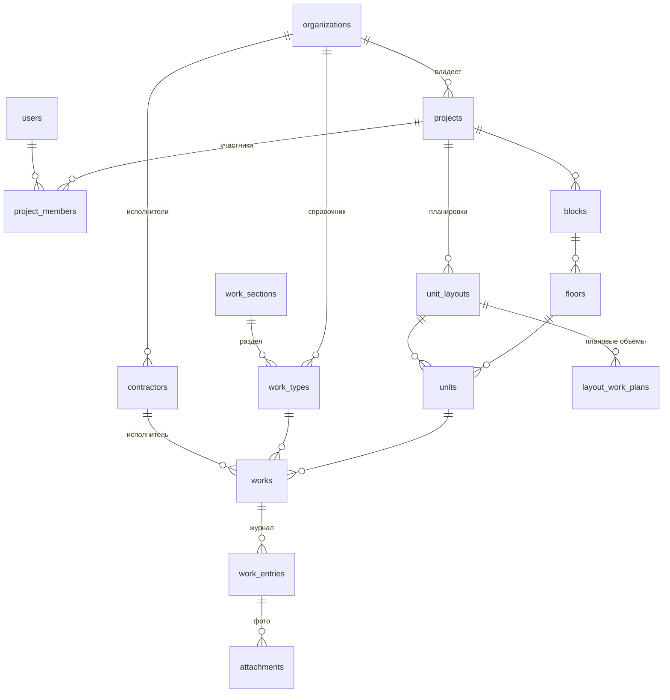

# Brick by brick — техническое задание на MVP

Версия 0.1 · черновик для обсуждения с разработчиком.

Связанные материалы:
- кликабельный прототип — [`prototype/index.html`](../prototype/index.html);
- схема базы данных — [`docs/db/schema.sql`](db/schema.sql), проверка правил — [`docs/db/check.sql`](db/check.sql).

Если прототип и ТЗ расходятся, верным считается ТЗ.

---

## 1. Цель MVP

Дать генподрядчику и застройщику единое место, где видно, **какие работы выполнены и приняты в каждой квартире**, без отчётов в Excel и WhatsApp.

MVP считается успешным, если на пилотном объекте:
- прораб каждый рабочий день вносит факт с телефона;
- технадзор принимает работы и выставляет замечания в системе, а не на бумаге;
- руководитель смотрит готовность в шахматке, не запрашивая отчёт.

## 2. Рамки

**Входит в MVP:** структура объекта, справочник работ, плановые объёмы по планировкам, факт, приёмка частями, замечания, фото, шахматка, массовые операции, история, выгрузка в Excel, роли, офлайн-режим для ввода факта.

**Не входит** (следующие версии): стоимость и акты на оплату (аналог КС-2/КС-3), график план/факт по датам, уведомления в WhatsApp/Telegram, шахматка продаж, кабинет покупателя, ЭЦП, материалы и склад, интеграция с 1С, нативные мобильные приложения.

## 3. Термины

| Термин | Значение |
|---|---|
| Организация | Компания-клиент (генподрядчик или застройщик). Все данные принадлежат ей |
| Проект | Объект строительства, ЖК |
| Блок | Корпус, секция или подъезд |
| Этаж | Номер −1…N и тип: подземный, жилой, коммерческий, технический, кровля |
| Помещение | Квартира, коммерческое, техническое или МОП |
| Планировка | Типовой вариант помещения («2-комн. тип А, 61 м²») |
| Вид работы | Позиция справочника: название, раздел (АР, ВК, ОВ, ЭОМ, Отделка), единица измерения |
| Работа | Вид работы в конкретном месте: помещение, этаж, блок или весь проект |
| План | Плановый объём работы |
| Факт | Выполненный объём, сумма записей прораба |
| Принято | Объём, принятый технадзором, сумма записей приёмки |
| К приёмке | Факт минус принято |
| Запись журнала | Неизменяемое действие: факт, приёмка, замечание, устранение, изменение плана |

## 4. Роли и права

Роль назначается **в рамках проекта**. У одного человека на разных проектах могут быть разные роли.

| Действие | Админ | ПТО | Прораб | Технадзор | Субподрядчик | Руководитель |
|---|:-:|:-:|:-:|:-:|:-:|:-:|
| Смотреть проект и шахматку | ✓ | ✓ | ✓ | ✓ | только свои работы | ✓ |
| Создавать блоки, этажи, помещения | ✓ | ✓ | | | | |
| Вести справочник работ и планировки | ✓ | ✓ | | | | |
| Задавать и менять план | ✓ | ✓ | | | | |
| Назначать исполнителя работы | ✓ | ✓ | ✓ | | | |
| Вносить факт | | | ✓ | | ✓ (свои работы) | |
| Отмечать «замечание устранено» | | | ✓ | | ✓ (свои работы) | |
| Принимать объём | | | | ✓ | | |
| Выставлять замечание | | | | ✓ | | |
| Приглашать участников | ✓ | | | | | |
| Выгрузка в Excel | ✓ | ✓ | ✓ | ✓ | | ✓ |

Права проверяет сервер. Интерфейс только скрывает недоступные кнопки.

## 5. Функциональные требования

Каждое требование имеет номер, на него ссылаются критерии приёмки (раздел 9).

### 5.1. Вход и участники

- **F-1.1** Вход по номеру телефона (+7) с кодом из SMS. Запасной вариант — email и пароль.
- **F-1.2** Админ приглашает участника по номеру телефона и назначает роль в проекте. Для роли «Субподрядчик» нужно указать компанию из справочника исполнителей.
- **F-1.3** Язык интерфейса: русский или казахский, выбирает пользователь. Названия работ и помещений вводятся клиентом и не переводятся.

### 5.2. Проекты

- **F-2.1** Список проектов организации с процентом готовности каждого.
- **F-2.2** Карточка проекта: название, город, адрес, застройщик, генподрядчик, класс жилья, вид отделки, плановый срок ввода.
- **F-2.3** Сводка на карточке: общая готовность, количество работ по статусам, количество открытых замечаний, объём к приёмке.
- **F-2.4** Проект можно архивировать. Архивный проект доступен только на чтение.

### 5.3. Структура объекта

- **F-3.1** Мастер создания блока: название, этажи с и по, тип этажей, раскладка помещений на типовом этаже (например «1к-А, 1к-А, 2к-Б, 2к-Б, 3к-В»), начальный номер квартиры, порядок нумерации (сквозная по блоку).
- **F-3.2** Мастер создаёт этажи, помещения и все работы по шаблонам планировок за одну операцию. Для блока на 12 этажей и 6 помещений на этаже это занимает не больше 5 секунд.
- **F-3.3** После генерации можно вручную добавить, удалить или переименовать этаж или помещение, а также сменить планировку помещения.
- **F-3.4** На каждом жилом этаже можно автоматически создать помещение «МОП».
- **F-3.5** Работы можно привязать к этажу, блоку или проекту (фасад, кровля, благоустройство).
- **F-3.6** Помещение с внесённым фактом удалить нельзя. Сначала его нужно перевести в архив.

### 5.4. Справочник работ и планировки

- **F-4.1** Справочник разделов (АР, ВК, ОВ, ЭОМ, Отделка…) и видов работ: название, раздел, единица (м², м³, п.м., шт., кг, т), признак «скрытая работа», порядок.
- **F-4.2** Импорт справочника из Excel по шаблону.
- **F-4.3** Планировки проекта: название, тип помещения, комнаты, площадь, список работ с плановыми объёмами.
- **F-4.4** Изменение объёма в планировке можно применить ко всем помещениям этой планировки. Система показывает, сколько работ изменится, и пропускает работы, у которых план изменён вручную (`plan_overridden`).
- **F-4.5** У отдельной работы план можно изменить вручную. После этого она помечается «изменён вручную», и шаблон её больше не меняет.

### 5.5. Шахматка

- **F-5.1** Вкладки блоков с процентом готовности каждого.
- **F-5.2** Сетка: строки — этажи сверху вниз, клетки — помещения в порядке `sort_order`. На клетке номер, тип и площадь, процент готовности, отметка открытого замечания.
- **F-5.3** Режимы раскраски:
  - по общей готовности (градиент 0–100%);
  - по выбранному виду работы (цвет статуса);
  - «что ждёт приёмки».
- **F-5.4** Фильтр по исполнителю: показываются только его работы.
- **F-5.5** Шахматка блока до 30 этажей и 400 помещений открывается на телефоне со средним 4G не дольше 2 секунд.
- **F-5.6** Нажатие на клетку открывает карточку помещения.

### 5.6. Карточка помещения и работы

- **F-6.1** Навигационная цепочка: проект › блок › этаж › помещение. Переходы к соседнему помещению и на этаж выше или ниже.
- **F-6.2** Характеристики помещения и общая готовность.
- **F-6.3** Список работ в технологическом порядке. По каждой работе: статус, факт и план, принятый объём, исполнитель, отметка о наличии фото.
- **F-6.4** Карточка работы: план, выполнено, принято, двухцветная полоса (принято / к приёмке), действия по роли, история.

### 5.7. Факт выполнения

- **F-7.1** Прораб вносит объём, дату выполнения (по умолчанию сегодня, будущие даты запрещены), комментарий и фото (необязательно).
- **F-7.2** Кнопка «Выполнено полностью» вносит остаток до плана.
- **F-7.3** Если факт превышает план больше чем на 5%, нужен комментарий с причиной.
- **F-7.4** Ошибку исправляют записью с отрицательным объёмом и обязательным комментарием. Факт не может стать меньше принятого объёма.
- **F-7.5** Если весь плановый объём работы уже принят, внести факт нельзя, пока ПТО не увеличит план.

### 5.8. Приёмка и замечания

- **F-8.1** Технадзор принимает объём целиком или частями, но не больше, чем «к приёмке».
- **F-8.2** Замечание: текст (обязательно) и фото (необязательно). Пока замечание открыто, принять объём нельзя.
- **F-8.3** У работы может быть только одно открытое замечание.
- **F-8.4** Прораб отмечает «Замечание устранено» с комментарием и фото (необязательно). Работа возвращается в очередь на приёмку.
- **F-8.5** Список открытых замечаний по проекту с фильтром по блоку и исполнителю.

### 5.9. Массовые операции

- **F-9.1** В шахматке включается режим выбора. Выбор по клеткам или целым этажом (нажатие на номер этажа).
- **F-9.2** Для выбранных помещений и одного вида работы:
  - прораб: «Выполнено полностью»;
  - технадзор: «Принять весь объём к приёмке».
- **F-9.3** После операции система показывает итог: сколько обработано и сколько пропущено, с причиной (работы нет, статус не подходит, есть замечание).
- **F-9.4** Массовая операция выполняется в одной транзакции и создаёт отдельную запись журнала на каждую работу.

### 5.10. Фото

- **F-10.1** К записям «факт», «замечание» и «устранено» можно приложить до 10 фото. Фото необязательно.
- **F-10.2** На телефоне можно снять камерой или выбрать из галереи.
- **F-10.3** Перед загрузкой фото уменьшается на устройстве до 1600 px по длинной стороне (JPEG, качество около 0,8). Оригинал не хранится.
- **F-10.4** Хранение в S3-совместимом хранилище. Доступ по временным ссылкам только участникам проекта.
- **F-10.5** Миниатюры в истории, просмотр на весь экран.

### 5.11. История

- **F-11.1** У каждой работы есть полная история: дата, автор, действие, объём, комментарий, фото.
- **F-11.2** Записи журнала нельзя изменить или удалить, это гарантирует база данных.
- **F-11.3** Лента последних действий по проекту с фильтром по автору и дате.

### 5.12. Выгрузка

- **F-12.1** Выгрузка в Excel: по проекту или блоку, строки — работы, столбцы — блок, этаж, помещение, вид работы, единица, план, факт, принято, статус, исполнитель.
- **F-12.2** Выгрузка журнала за период: дата, работа, место, тип записи, объём, автор. Это основа для будущих актов.

## 6. Правила статусов

Статус не выставляется вручную. Его вычисляет база данных из плана, факта, принятого объёма и наличия открытого замечания, в таком порядке:

| Условие | Статус |
|---|---|
| Есть открытое замечание | Замечания |
| Принято ≥ план | Принято |
| Факт ≥ план | Выполнено, ждёт приёмки |
| Факт > 0 | В работе |
| иначе | Не начато |

Готовность работы = (принято + 0,9 × к приёмке) / план, не больше 100%. Готовность помещения, этажа, блока и проекта — среднее по работам.

Правила реализованы в триггерах `docs/db/schema.sql` и проверены сценарием `docs/db/check.sql`.

## 7. Нефункциональные требования

| № | Требование |
|---|---|
| N-1 | **PWA**: сайт устанавливается на телефон как приложение. Поддерживаются последние 2 версии Chrome, Safari (iOS 16+), Edge, Яндекс Браузера |
| N-2 | **Офлайн**: внесение факта, «устранено» и фото работает без сети. Записи хранятся в очереди на устройстве и отправляются при появлении связи. У каждой записи есть `client_id`, поэтому повторная отправка не создаёт дубль |
| N-3 | **Конфликты офлайна**: если запись при синхронизации нарушает правило (например, план уже изменили), сервер её отклоняет, а пользователь видит причину и может внести запись заново |
| N-4 | **Хранение данных** на серверах в Казахстане (требование закона о персональных данных; перед запуском проверить с юристом) |
| N-5 | **Безопасность**: HTTPS, сессии с истечением, разграничение данных организаций на уровне запросов к базе, журнал входов |
| N-6 | **Резервные копии** базы ежедневно, хранение 30 дней, проверка восстановления раз в месяц |
| N-7 | **Производительность**: ответ API на типовые запросы — до 300 мс (95-й перцентиль) при 50 одновременных пользователях на проекте |
| N-8 | **Доступность интерфейса**: работа с клавиатуры, контраст текста не ниже WCAG AA, кнопки на телефоне не меньше 44 px |
| N-9 | **Язык**: все тексты интерфейса вынесены в файлы перевода (ru, kk) |

## 8. Данные и API

### 8.1. Модель данных

Полная схема с ограничениями и триггерами — в [`docs/db/schema.sql`](db/schema.sql). Ключевые решения:
- **Журнал только на добавление.** Факт, принятое, план и статус работы — это кэш в `works`, его пересчитывает триггер. Прямое изменение этих полей приложением запрещено.
- **Работа привязана к одному уровню:** помещению, этажу, блоку или проекту. Это гарантирует ограничение в базе.
- **Параллельные записи** по одной работе выполняются последовательно (`select … for update`), поэтому две приёмки одновременно не превысят факт.
- **UUID** во всех ключах: записи можно создавать на телефоне офлайн.

### 8.2. API (REST, черновик)

| Метод и путь | Назначение |
|---|---|
| `POST /auth/sms`, `POST /auth/verify` | Вход по SMS |
| `GET /projects` | Список проектов с готовностью |
| `GET /projects/{id}` | Карточка и сводка |
| `POST /projects/{id}/blocks/generate` | Мастер создания блока (F-3.1) |
| `GET /blocks/{id}/chessboard?color_by=…&contractor=…` | Данные шахматки из `v_unit_cells` |
| `GET /units/{id}` | Карточка помещения с работами |
| `GET /works/{id}` | Карточка работы с историей |
| `POST /works/{id}/entries` | Новая запись журнала: `type`, `qty`, `entry_date`, `comment`, `remark_id`, `client_id` |
| `POST /entries/batch` | Массовая операция и синхронизация офлайн-очереди |
| `POST /uploads` → `PUT` по ссылке | Загрузка фото напрямую в хранилище |
| `PUT /layouts/{id}/plans` + `POST /layouts/{id}/apply` | Шаблон объёмов и его применение (F-4.4) |
| `GET /projects/{id}/export.xlsx`, `GET /projects/{id}/entries.xlsx?from=…&to=…` | Выгрузки |

Ошибки правил возвращаются с кодом 422 и понятным текстом из триггера, например «Нельзя принять больше выполненного: к приёмке 20».

### 8.3. Рекомендуемый стек

- Фронтенд: React или Next.js, PWA (Service Worker, IndexedDB для офлайн-очереди).
- Бэкенд: Node.js (NestJS) или Python (FastAPI). Выбор за командой разработки.
- База: PostgreSQL 16.
- Файлы: S3-совместимое хранилище в казахстанском облаке.
- SMS: казахстанский SMS-шлюз.

## 9. Критерии приёмки MVP

Сценарии выполняются на тестовом проекте (3 блока, около 200 помещений):

1. Админ создаёт проект и блок на 12 этажей мастером. Все помещения и работы созданы с планом из планировок (F-3.1, F-3.2).
2. ПТО меняет объём штукатурки в планировке «2к». План меняется во всех 2-комн. квартирах, кроме одной, где он задан вручную (F-4.4, F-4.5).
3. Прораб с телефона вносит 50 м² штукатурки с фото. Статус «В работе», фото видно в истории (F-7.1, F-10.1).
4. Прораб в режиме полёта вносит факт по трём квартирам и включает сеть. Записи появляются на сервере ровно один раз (N-2).
5. Технадзор принимает 30 из 50 м². Принято 30, к приёмке 20. Попытка принять 30 отклоняется с понятным сообщением (F-8.1).
6. Технадзор выставляет замечание. Приёмка заблокирована. Прораб отмечает устранение, технадзор принимает остаток (F-8.2–F-8.4).
7. Прораб выбирает этажи 5–7 и отмечает «Стяжка пола — выполнено полностью». Итог показывает обработанные и пропущенные помещения (F-9.1–F-9.3).
8. Субподрядчик видит только свои работы и не может принять объём (раздел 4).
9. Руководитель выгружает Excel по блоку. Цифры совпадают с шахматкой (F-12.1).
10. Попытка изменить запись журнала через API отклоняется (F-11.2).

## 10. Этапы (предварительная оценка)

Оценка для команды из 2 разработчиков и дизайнера на неполный день. Уточняется после выбора команды.

| Этап | Содержание | Срок |
|---|---|---|
| 0. Подготовка | Дизайн экранов по прототипу, окружение, CI | 1–2 недели |
| 1. Основа | Вход, организации, проекты, роли, структура объекта, мастер блока | 2–3 недели |
| 2. Работы | Справочник, планировки, шаблоны объёмов, журнал, факт, приёмка, замечания | 2–3 недели |
| 3. Шахматка и фото | Шахматка, карточки, фото, массовые операции | 2 недели |
| 4. Офлайн и выгрузки | PWA, офлайн-очередь, Excel | 1–2 недели |
| 5. Пилот | Тестирование по разделу 9, запуск на объекте, исправления | 2 недели |

Итого ориентировочно **10–14 недель** до пилота.

## 11. Открытые вопросы

1. Нужна ли в MVP приёмка субподрядчиком своих работ до технадзора (двухступенчатая приёмка)?
2. Делать ли фото обязательным для скрытых работ (признак `is_hidden_work` уже есть в схеме)?
3. Нумерация квартир сквозная по проекту или по блоку?
4. Нужен ли казахский язык уже в пилоте или достаточно русского?
5. Кто первый пилотный клиент и сколько у него объектов и пользователей?
